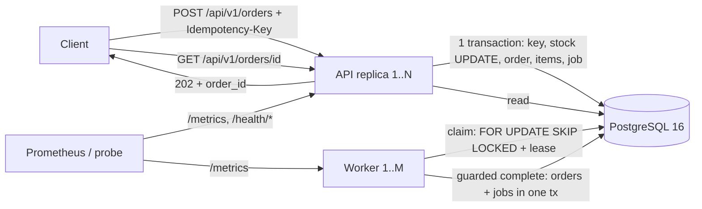

# Architecture

## Components
- **API** (2+ replicas, stateless): validates requests, runs the reservation transaction, serves reads and /metrics.
- **Worker** (2+ replicas): claims jobs from Postgres, completes orders, retries, dead-letters poison jobs.
- **PostgreSQL 16**: the only stateful component; holds stock, orders, idempotency keys and the job queue.

## Data flow

## Order lifecycle
1. `POST /api/v1/orders`: the transaction commits, order `queued`, job `queued`, response 202.
2. A worker claims the job (state `processing`, lease set) and the order becomes `processing`.
3. On success: order `completed`, job `completed`, in one transaction.
4. On failure: `attempts++`, `next_run_at` set with exponential backoff. If `attempts >= max_attempts`: job `dead`, order `failed`, stock not restored.
5. If a worker dies: the lease expires (`locked_until < now()`), another worker re-claims the job. The guarded completion keeps the effect exactly-once.

## Failure behaviour
| Failure | Result |
|---|---|
| Client retries a request | Same key + same payload returns the original order_id |
| API replica restarts | No state lost; the key lives in Postgres |
| Worker killed mid-job | Lease expires, another worker finishes, order completes once |
| Postgres down | /health/ready returns 503; /health/live stays 200 |
| Poison job | Bounded retries, then dead letter, order failed |